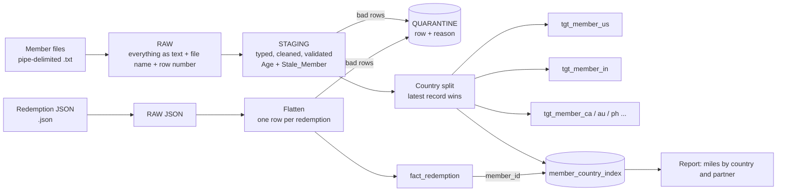

# SkyPoints Member ETL
## to write the readme file i specifically use the claude as a pair translator in better wordings##
Loads the SkyPoints loyalty member files and the partner redemption JSON feed, cleans and validates them, splits members into one table per country with "latest record wins", and joins redemptions back to the member profile.

The pipeline runs locally on DuckDB so anyone can run and test it with one command. The same design is written for Snowflake in `sql/snowflake/`.

## Design



| Layer | What it holds | Why |
|---|---|---|
| Raw | Every field as text, with file name and row number | Nothing is lost, and any row can be traced back to its file |
| Staging | Typed columns, cleaned values, Age, Stale_Member | One place for all validation rules |
| Quarantine | Rejected rows with a reason | Bad data is visible, never silently dropped |
| Country tables | One table per country | What the brief asks for |
| Member country index | Member id, current country, file date | Makes "latest record wins" and safe re-runs possible |
| Fact redemption | One row per transaction | Flattened JSON, joined to members by member id |

## How to run

```
python3 -m venv .venv
source .venv/bin/activate
pip install -r requirements.txt
python -m pytest
PYTHONPATH=src python -m skypoints.pipeline --db skypoints.duckdb data/sample/*
```

`pytest` shows 32 passed. The last command loads two sample member files and one redemption file, then prints the report.

Expected result of the demo run:

- Country tables: `tgt_member_au` 2, `tgt_member_ca` 2, `tgt_member_in` 1, `tgt_member_ph` 1, `tgt_member_us` 2.
- Member quarantine reasons, one row each: `column_count_mismatch`, `duplicate_member_in_file`, `invalid_enrollment_date`, `missing_member_id`, `missing_member_name`, `unknown_or_missing_country`.
- Redemption quarantine reasons: `duplicate_txn_id`, `invalid_status`, `unknown_member`.
- Redemptions by country and partner: CA AeroLink 1 transaction / 12000 miles completed / 0 pending; CA SkyPoints 1 / 0 / 5000; IN AeroLink 1 / 3000 / 0.

The demo shows the main cases: Elena moves from USA to CAN in the second file and ends up only in Canada, and a member with a 7-digit DOB is repaired.

## Requirements covered

1. **DDL** for raw, staging and country tables: `sql/` for DuckDB, `sql/snowflake/` for Snowflake.
2. **Staging load** with `Age` (birthday-aware, as of the date in the file name) and `Stale_Member` (more than 90 days since the last flight date; exactly 90 is not stale).
3. **Country split** with latest record wins: if a member appears in a later file under a different country, they are removed from the old country table and written to the new one. An older file replayed later cannot move them back.
4. **JSON flatten**: each document holds one member and an array of redemptions; the array becomes one row per redemption. Redemptions join to the member profile through `member_country_index`, so the country of a redemption is always the member's current country.
5. **Validations**: mandatory fields, key uniqueness inside a file, field lengths, valid dates, known country, valid status and miles, duplicate transaction ids, redemptions of unknown members. A row-count check after staging fails the run if rows disappear without being quarantined.

## Issues found in the sample data

- Country values differ between files (USA, IND, AUS, CAN and others), so a mapping table turns them into two-letter codes. Unknown countries are quarantined.
- DOB sometimes loses its leading zero (7 digits instead of 8). It is repaired and counted as a warning.
- DOB day/month order is ambiguous. See the assumptions below.
- Member ids differ in length between rows. A warning is recorded for the outliers.
- Agent_Name and Post Code are not always filled.
- The brief names `Member_Name` as the key, but names repeat under different member ids. The pipeline keys on `Member_ID` and records a warning when the same name appears under different ids.
- Column names in the brief differ slightly from the files, so columns are matched by header name, not position.

## Assumptions and open questions for the client

- DOB format is DDMMYYYY. Some samples look month-first, so this may need to be MMDDYYYY. It is one setting (`DOB_FORMAT` in `src/skypoints/config.py`).
- Other dates are YYYYMMDD.
- The key is `Member_ID`.
- Tier codes are GLD, SLV, PLT. Active flags are A and I. Redemption statuses are COMPLETED, PENDING, CANCELLED. Anything else is flagged or quarantined.
- The run date is the date in the file name, so Age and Stale_Member give the same answer on every re-run.
- A redemption for a member with no profile is quarantined, not loaded.

## Scale: billions of records per day

- Files are loaded incrementally, one file at a time, and every table row carries its source file, so a failed file can be re-run alone.
- Re-runs are safe: quarantine and warnings for a file are cleared and rewritten, country rows are deleted and re-inserted in one transaction, and redemptions are merged on transaction id.
- Only the members present in a batch are touched. The full country tables are never rewritten.
- In Snowflake, country tables and the redemption fact are clustered on member id, the raw JSON stays in a VARIANT column, and the loads use `COPY INTO`, `MERGE` and `LATERAL FLATTEN`, which run in parallel on a warehouse.
- Per-run quarantine counts and warnings make data quality visible without reading the data.

## Trade-off: one table per country

The brief asks for one table per country, and that is what is built. A new country needs a mapping row, a table, and (in the Snowflake script) a delete and an insert. In the Python version the table is created on demand. A single table partitioned by country would be simpler to run at very large scale, and the country tables could then be views over it.

## Snowflake scripts

`sql/snowflake/` has four scripts: tables, staging, country split, and redemptions. They follow the same design and rules as the DuckDB version, with the same quarantine reasons and warnings. The Python tests run on DuckDB. The Snowflake scripts were checked with a Snowflake SQL parser but are not run by the tests.

## Project layout

```
docs/PLAN.md              the plan written before building
sql/                      DuckDB DDL and SQL templates
sql/snowflake/            Snowflake DDL and load scripts
src/skypoints/            parse, staging, checks, country split, redemptions, pipeline
tests/                    32 tests
data/sample/              sample member files and redemption feed
```

## How AI was used

I used Claude as a pair-programming assistant for planning, writing the code and mostly to perform the tests, and drafting this README and the descriptions and comments . I ran every step myself, checked the output against the sample data, and made the decisions listed in the assumptions section. The commits and pull requests were made step by step in the order of the plan in `docs/PLAN.md`.